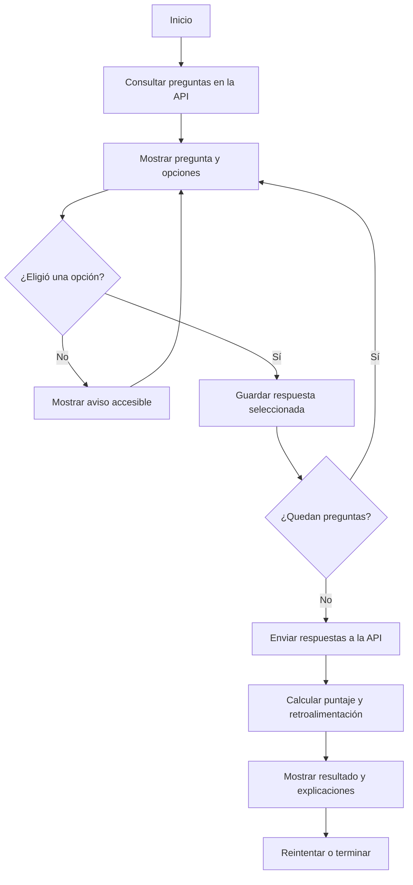
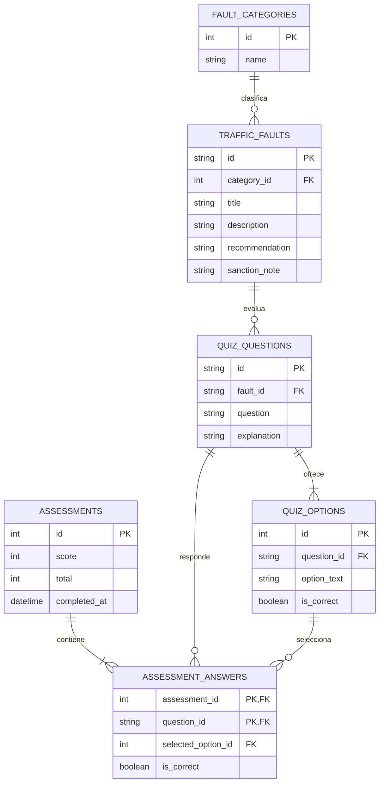

# CECyTO Vial

Prototipo educativo para conocer faltas viales y practicar decisiones responsables en Villa Victoria. Incluye una interfaz adaptable, un cuestionario con calificación inmediata, una API local y un esquema relacional de referencia.

> **Aviso:** las faltas y recomendaciones incluidas son datos didácticos de ejemplo, no una transcripción del reglamento ni asesoría legal. Las notas de sanción están pendientes de validación municipal y no muestran montos. Verifica con fuentes oficiales municipales la clasificación, obligaciones y sanciones vigentes antes de usar o publicar datos oficiales.

## Requisitos

- Node.js 22.13 o posterior (incluye `node:sqlite`).
- No requiere instalar paquetes.

## Instalación y ejecución

1. Abre una terminal en la carpeta del proyecto.
2. Ejecuta `npm start`.
3. Abre `http://localhost:3000` en el navegador.
4. Para usar otro puerto, define la variable `PORT` antes de ejecutar el servidor.

## Pruebas

Ejecuta `npm test` para validar la API, el cuestionario y las rutas principales.

## Estructura

```text
.
├── app.js                  # Interfaz y cuestionario
├── data/
│   ├── faults.json         # Catálogo inicial de faltas educativas
│   └── questions.json      # Preguntas y respuestas para el servidor
├── database/
│   └── schema.sql          # Esquema relacional de referencia
├── index.html
├── server.js               # Servidor estático y API JSON
├── styles.css
└── test/
    └── server.test.js
```

## API local

- `GET /api/faults` devuelve las faltas; admite `?category=Grave`.
- `GET /api/questions` devuelve preguntas y opciones, sin exponer la respuesta correcta.
- `POST /api/assessments` recibe `{"answers":[{"questionId":"q1","selectedIndex":0}]}` y devuelve el puntaje y la retroalimentación.

La aplicación usa SQLite real. Al iniciar, crea `data/cecyto-vial.sqlite` desde el esquema de `database/schema.sql` y carga o actualiza las categorías, faltas, preguntas y opciones con los datos iniciales de los archivos JSON. Las respuestas correctas se consultan en el servidor y cada intento y sus respuestas se guardan en tablas relacionales. El archivo SQLite local está excluido de Git.

## Diagramas del avance

### Flujo del cuestionario



### Diagrama entidad-relación



### Bosquejo de interfaz (wireframe)

```text
┌──────────────────────────────────────────────────────────────┐
│ CECyTO Vial                 Inicio  Reglamento  Cuestionario  │
├──────────────────────────────────────────────────────────────┤
│ En el camino, cada decisión cuenta.     Ilustración / camino │
│ [Poner a prueba lo que sé] [Explorar reglamento]             │
├──────────────────────────────────────────────────────────────┤
│ Aprende hoy protege mañana · 03 categorías · 08 preguntas    │
├──────────────────────────────────────────────────────────────┤
│ REGLAS CLARAS, CAMINOS SEGUROS                                │
│ [Todas] [Leves] [Graves] [Gravísimas] [Administrativas]      │
│ ┌──────────────┐ ┌──────────────┐ ┌──────────────┐           │
│ │ Falta        │ │ Falta        │ │ Falta        │           │
│ │ Sanción*     │ │ Sanción*     │ │ Sanción*     │           │
│ │ Prevención   │ │ Prevención   │ │ Prevención   │           │
│ └──────────────┘ └──────────────┘ └──────────────┘           │
├──────────────────────────────────────────────────────────────┤
│ CUESTIONARIO          │ Pregunta, opciones y progreso        │
│ Aprende practicando   │ [A] [B] [C] [Confirmar respuesta]    │
│                       │ Resultado y explicación inmediata     │
└──────────────────────────────────────────────────────────────┘
```

`*` Nota de sanción pendiente de verificación con la autoridad municipal.

## Publicación del repositorio

El proyecto debe publicarse en un repositorio remoto propio. No uses el repositorio de otro proyecto. Crea un repositorio vacío en tu cuenta de GitHub, copia su URL y configura `git remote add origin <URL>` desde la carpeta del proyecto; después publica la rama principal con `git push -u origin main`. El usuario necesita iniciar sesión y tener permiso de escritura en esa cuenta.

## Repositorio remoto

Para publicar este prototipo, crea un repositorio vacío en GitHub, GitLab o Bitbucket, inicializa Git en esta carpeta, agrega el remoto y sube la rama principal. No incluyas secretos ni resultados locales.
