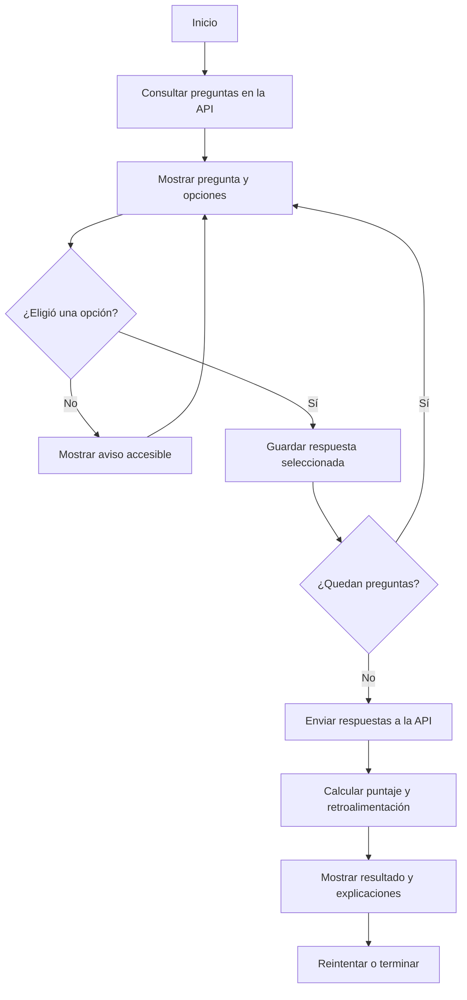
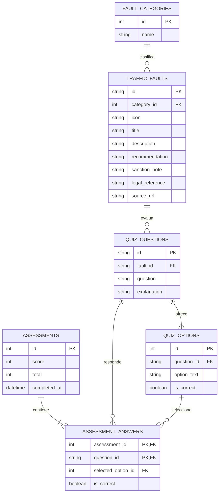

# CECyTO Vial

Sistema educativo para conocer disposiciones de movilidad y seguridad vial del Bando Municipal de Villa Victoria 2026. Incluye una interfaz adaptable, un cuestionario con calificación inmediata, una API local y una base de datos SQLite conectada.

> **Alcance legal:** el catálogo resume disposiciones del [Bando Municipal de Villa Victoria 2026](https://villavictoria.edomex.gob.mx/sites/villavictoria.edomex.gob.mx/files/files/acerca%20del%20ayuntamiento/Marco%20Juridico/BANDO%20MUNICIPAL%20VV26%20LIGERO.pdf), vigente desde el 5 de febrero de 2026 (artículo segundo transitorio). Cada ficha muestra el artículo de referencia. Las categorías de la interfaz solo organizan el aprendizaje: el Bando remite la aplicación de sanciones de movilidad a la Ley de Movilidad del Estado de México y su Reglamento (artículo 192, fracción XII), y la calificación cívica a la Ley y el Reglamento de Justicia Cívica (artículos 217–218). No se inventan multas ni grados generales de faltas. El contenido es educativo y no sustituye la consulta del texto oficial ni la orientación de la autoridad.

## Requisitos

- Node.js 22.13 o posterior (incluye `node:sqlite`).
- No requiere instalar paquetes.

## Instalación y ejecución

1. Abre una terminal en la carpeta del proyecto.
2. Ejecuta `npm start`.
3. Abre `http://localhost:3000` en el navegador.
4. Para usar otro puerto, define la variable `PORT` antes de ejecutar el servidor.

## Pruebas

Ejecuta `npm test` para validar la API, el cuestionario y las rutas principales.

## Estructura

```text
.
├── app.js                  # Interfaz y cuestionario
├── data/
│   ├── faults.json         # Catálogo con referencias al Bando Municipal 2026
│   └── questions.json      # Preguntas y respuestas para el servidor
├── database.js             # Inicialización SQLite, carga y consultas
├── database/
│   └── schema.sql          # Esquema relacional
├── index.html
├── server.js               # Servidor estático y API JSON
├── styles.css
└── test/
    └── server.test.js
```

## API local

- `GET /api/faults` devuelve las disposiciones; admite `?category=Movilidad`.
- `GET /api/questions` devuelve preguntas y opciones, sin exponer la respuesta correcta.
- `POST /api/assessments` recibe `{"answers":[{"questionId":"q1","selectedIndex":0}]}` y devuelve el puntaje y la retroalimentación.

La aplicación usa SQLite real. Al iniciar, crea `data/cecyto-vial.sqlite` desde el esquema de `database/schema.sql` y carga o actualiza las categorías, faltas, preguntas y opciones con los datos iniciales de los archivos JSON. Las respuestas correctas se consultan en el servidor y cada intento y sus respuestas se guardan en tablas relacionales. El archivo SQLite local está excluido de Git.

## Diagramas del avance

### Flujo del cuestionario



### Diagrama entidad-relación



### Bosquejo de interfaz (wireframe)

```text
┌──────────────────────────────────────────────────────────────┐
│ CECyTO Vial                 Inicio  Reglamento  Cuestionario  │
├──────────────────────────────────────────────────────────────┤
│ En el camino, cada decisión cuenta.     Ilustración / camino │
│ [Poner a prueba lo que sé] [Explorar reglamento]             │
├──────────────────────────────────────────────────────────────┤
│ Aprende hoy protege mañana · 04 categorías · 08 preguntas    │
├──────────────────────────────────────────────────────────────┤
│ REGLAS CLARAS, CAMINOS SEGUROS                                │
│ [Todas] [Movilidad] [Seguridad vial] [Alcoholímetro] [Cívica] │
│ ┌──────────────┐ ┌──────────────┐ ┌──────────────┐           │
│ │ Disposición  │ │ Disposición  │ │ Disposición  │           │
│ │ Artículo     │ │ Artículo     │ │ Artículo     │           │
│ │ Prevención   │ │ Prevención   │ │ Prevención   │           │
│ └──────────────┘ └──────────────┘ └──────────────┘           │
├──────────────────────────────────────────────────────────────┤
│ CUESTIONARIO          │ Pregunta, opciones y progreso        │
│ Aprende practicando   │ [A] [B] [C] [Confirmar respuesta]    │
│                       │ Resultado y explicación inmediata     │
└──────────────────────────────────────────────────────────────┘
```

### Fuente normativa consultada

- **Bando Municipal de Villa Victoria 2026**, versión oficial alojada por el Ayuntamiento: [consultar PDF](https://villavictoria.edomex.gob.mx/sites/villavictoria.edomex.gob.mx/files/files/acerca%20del%20ayuntamiento/Marco%20Juridico/BANDO%20MUNICIPAL%20VV26%20LIGERO.pdf).
- Artículo 192, fracción VI: estacionamiento que obstruye la circulación y medidas de retiro.
- Artículo 192, fracción XII: atribuciones en movilidad, alcoholímetro y límites de alcohol.
- Artículo 193, fracciones I y V: señalamientos, límites indicados, circulación y dispositivos de comunicación.
- Artículos 217 y 218: disposiciones generales de infracciones y calificación por el Juzgado Cívico.
- Artículo segundo transitorio: entrada en vigor el 5 de febrero de 2026.

El Bando remite cuestiones concretas de movilidad a la Ley estatal y su Reglamento, y el procedimiento cívico a su propia Ley y Reglamento municipal. Este prototipo no reemplaza esos instrumentos ni asigna sanciones o montos que no aparecen en los artículos citados.

## Publicación del repositorio

Repositorio público: [jujr091102mmcnrba7-boop/Cecyto_vial](https://github.com/jujr091102mmcnrba7-boop/Cecyto_vial). La base SQLite y las evaluaciones locales se excluyen de Git.
